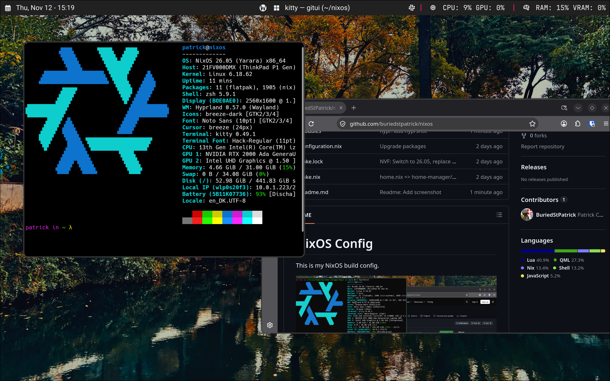

# NixOS Config

This is my NixOS build config. I am still figuring out best practices and such and how to make things.

The goals are to keep it:

1. Portable.
2. Easy to set up, build and maintain.
3. Opinionated with consistent ways to configure things.



> Note that this assumes a lot at the moment:
> 1. Your name is patrick.
> 2. You have your NixOS config at ~/nixos
> 3. You have a thinkpad with my exact hardware specs.

Obviously don't use this repo for more than inspiration for your own setup. I'm working on modularizing it into opinionated flakes.

## Build

```bash
# First time, assume this repo is at ~/nixos
sudo nixos-rebuild switch --flake ${HOME}/nixos#nixos

# Consecutive builds
nixbuild
```

## Edit config

```bash
nixedit
```

## Clean up old generations

```bash
nixclean
```
